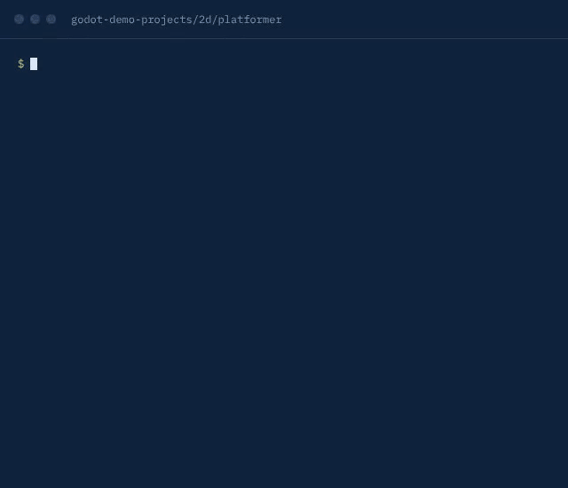

<div align="center">

# ReversePort

### Reverse engineer anything. Port it anywhere.

**One CLI and one MCP server that let your coding agent take apart apps, games, binaries and websites — and rebuild them.**

[](https://www.npmjs.com/package/reverseport)
[](https://www.npmjs.com/package/reverseport)
[](https://registry.modelcontextprotocol.io/v0/servers?search=io.github.laaielichter/reverseport)
[](docs/mcp-contracts.md#generated-catalog)
[](LICENSE)
[](docs/installation.md)

```bash
npx reverseport setup
```



<sub>A real run on <a href="https://github.com/godotengine/godot-demo-projects/tree/master/2d/platformer">Godot's 2D platformer demo</a>, JSON trimmed to the key fields.</sub>

[Website](https://laaielichter.github.io/Reverseport/) · [Quick start](#quick-start) · [Every agent](#works-with-every-agent) · [What it does](#what-it-does) · [How it compares](#how-it-compares) · [FAQ](#faq) · [Docs](#documentation)

</div>

---

See a feature you like in an app or a game? Ask your agent how it works — down to the decompiled function — and
then ask it to build your own version. Have a game in Godot and want it in Unity? Ask your agent to port it, unit by
unit, verified. No files at all? Give it a name or a store page.

ReversePort gives agents one consistent way to do all of that:

- 🔍 **Understand anything** — engine and version of any project or exported game, dependency graphs, scenes,
  symbols in 30+ languages, executables, packs and unknown data. No build step, no dependencies.
- 🧠 **Go deep** — decompile, cross-reference and trace native, managed (.NET), Android, Electron/JavaScript,
  WebAssembly, firmware and browser targets through Ghidra, Hopper, IDA, JADX and more. ReversePort connects to the
  tools you have installed, drives them and shows the evidence behind every conclusion.
- 🌐 **No files? Still recon** — a name, a store page, a website or a public repo is enough to learn the engine,
  stack, file layout and open-source remakes from public sources.
- 🧩 **Rebuild precisely** — turn what you learned into a clean-room rebuild spec: every system, the parameters to
  measure on the original, a parity table and a project skeleton with every value as a tunable.
- 🚚 **Port for real** — Godot ⇄ Unity, Godot → Unreal, Godot → three.js, GDScript → C#, or language to language.
  Scenes and transforms convert automatically; code is ported by your agent with API maps; `port_verify` proves
  nothing was left behind.
- 🔒 **Local** — runs on your machine. Targets are only read; output goes to new folders. Nothing is uploaded to an
  analysis service and there is no extra API bill.

## Quick start

### 1. Connect your agent

With Node.js 22.19 or newer:

```bash
npx reverseport setup
```

Pick your agents, review the changes and approve. Setup registers one MCP server and installs the matching skill,
with backups of existing configuration. Restart your agent afterwards. Setup supports Claude Code, Codex, Cursor,
Gemini CLI, GitHub Copilot, OpenCode and [more agents](docs/installation.md#supported-agents); other clients can use
[manual MCP registration](docs/installation.md#mcp-registry).

**Claude Code plugin** (instead of setup for Claude Code — includes the server, the porting skills and the
`port-architect` agent; do not use both):

```text
/plugin marketplace add laaielichter/reverseport
/plugin install reverseport@reverseport
```

The same marketplace also offers the [sister plugins](#sister-tools) `stashpad@reverseport` and
`agentdisk@reverseport`.

**From source:**

```bash
git clone https://github.com/laaielichter/reverseport && cd reverseport
npm ci && npm run build
./bin/reverseport.mjs setup
```

The recon, build-inspection, lookup, blueprint and porting commands already work right after `git clone`, with no
install at all: `node bin/reverseport.mjs scan ./MyGame`.

### 2. Ask your agent

```text
Understand how search works in the Notes app, show me the evidence, and build a similar feature for my project.
```

That's it. The agent picks the tools; you get answers with the evidence behind them.

## Works with every agent

Any vendor, any framework, any model size — the same tools through the door that fits:

- **MCP**: `npx -y reverseport@latest setup` configures installed agents; `reverseport connect <client>` prints the
  snippet for any other MCP client (Windsurf, Cline, Continue, Zed, Goose, LM Studio, VS Code…).
- **MCP over HTTP**: `reverseport serve` → `http://127.0.0.1:32147/mcp`.
- **Function calling**: `/api/agent/tools?format=openai-strict|responses|anthropic|gemini`, plus OpenAPI 3.1 at
  `/api/openapi.json` for GPT Actions, LangChain, LlamaIndex, Semantic Kernel, CrewAI, AutoGen and n8n.
- **Shell-only agents**: JSON on stdout, errors as JSON on stderr, `reverseport describe <tool>`.

Built for the agent's circumstances too:

- **A short list by default.** About 45 tools are listed instead of almost 200. Every other tool is one call away:
  `engine_tools` finds it and `engine_call` runs it.
- **The list fits the agent.** Small or older models use `compact`, large-context agents use `full`, and an agent
  can switch itself with `set_tool_profile`.
- **One error shape everywhere**, with a code, whether retrying helps, and the exact next step.
- **A `next` field wherever there is an obvious next step** (graphs, truncated results, every porting step), with the exact call.
- **Agents are heard.** `share_feedback` leaves a note for the maintainers; it stays on the user's machine until
  they share it.

See [Connect any agent](docs/connect-any-agent.md).

## Prompts to try

| You ask                                                                  | ReversePort does                                                                |
| ------------------------------------------------------------------------ | ------------------------------------------------------------------------------- |
| _What is this game made with, and how is it built?_                      | `re_scan` → engine + version, languages, entry points, how it starts            |
| _Map this codebase and write ARCHITECTURE.md._                           | `re_graph`, `re_symbols`, `re_report`                                           |
| _What changed between build 43 and 44?_                                  | `re_compare` folder-to-folder and pack-to-pack, biggest changes first           |
| _Decompile the function that saves settings in this app and explain it._ | opens the binary, finds it, decompiles it, shows the evidence                   |
| _How does this Electron app talk to its native side?_                    | maps modules, IPC and Electron boundaries                                       |
| _What is `<some game>` made with? I don't have the files._               | `re_lookup` from public sources: engine with confidence, stack, layout, remakes |
| _Rebuild the movement of `<game>` as precisely as possible in Godot._    | `re_blueprint`: systems, parameters to measure, parity table, skeleton          |
| _Port my Godot game to Unity._                                           | `port_plan` → `port_unit`/`port_write` loop → `port_scene` → `port_verify`      |

```text
You:    Port my Godot game to Unity.
Agent:  re_scan → Godot 4.3, 6 scripts, 5 scenes, main scene main.tscn, autoload Global
        port_plan → 13 units, dependencies first; Unity scene builder + PORT-PLAN.md created
        port_unit / port_write × 7 → C# MonoBehaviours (signals → events, $Node → [SerializeField])
        port_scene × 5 → prefab and scene specs, transforms mirrored to Unity's axes
        port_verify → passed: 13/13 units, 0 leftovers, 0 missing functions
```

## What it does

### Understand and go deep

| Target                             | What you get                                                                                                                                                                        | Needs                                                                          |
| ---------------------------------- | ----------------------------------------------------------------------------------------------------------------------------------------------------------------------------------- | ------------------------------------------------------------------------------ |
| Source projects and exported games | Engine + version (Godot, Unity, Unreal, GameMaker, RPG Maker, Ren'Py, LÖVE, Defold, Bevy, MonoGame, web, Electron, Flutter, .NET, Go, Rust…), dependencies, cycles, scenes, symbols | Nothing                                                                        |
| Packs and archives                 | Godot `.pck` (also embedded in the `.exe`), zip/apk/jar, `.unitypackage`, tar.gz, asar — list and extract                                                                           | Nothing                                                                        |
| Native binaries                    | Mach-O, ELF, PE, wasm: functions, pseudocode, strings, xrefs, call paths, layout                                                                                                    | Ghidra, Hopper or IDA for decompilation ([setup](docs/installation.md#hopper)) |
| .NET assemblies                    | Metadata, CIL, native boundaries, build comparisons                                                                                                                                 | Nothing                                                                        |
| Android                            | Manifest, classes, decompiled methods, references, resources, devices                                                                                                               | JADX / Apktool / adb ([guide](docs/android-analysis.md))                       |
| JavaScript and Electron            | Modules, imports, source maps, Electron boundaries, runtime observation                                                                                                             | Nothing; a browser for runtime                                                 |
| Websites                           | Page, network and runtime evidence; stack fingerprint without files                                                                                                                 | A browser for runtime                                                          |
| Firmware, EVM, crashes, captures   | Regions and extraction, selectors, recorded crashes, HAR/mitmproxy captures                                                                                                         | See the [guides](docs/index.md)                                                |

### Rebuild and port

| From → to            | Code                             | Scenes / prefabs                             | Transforms  | Project skeleton            |
| -------------------- | -------------------------------- | -------------------------------------------- | ----------- | --------------------------- |
| Godot → **Unity**    | agent, with API map              | automatic → specs + one-click editor builder | Z-mirror    | scene builder script        |
| Godot → **Unreal**   | agent (.h/.cpp), with API map    | automatic → specs (cm, Z-up)                 | axes + ×100 | .uproject, module, targets  |
| Godot → **three.js** | agent (TypeScript), with API map | automatic → TypeScript builder modules       | unchanged   | Vite + TS + fixed-step loop |
| Godot → **Godot C#** | agent, with API map              | automatic (script paths swapped)             | unchanged   | .csproj, project.godot      |
| Unity → **Godot**    | agent (GDScript), with API map   | automatic → `.tscn`                          | Z-mirror    | project.godot               |
| Unity → **Unreal**   | agent, with API map              | —                                            | axes + ×100 | .uproject, module           |
| any → **language**   | agent                            | —                                            | —           | —                           |

## CLI

Everything the agent can do, you can do from the shell. Results are JSON.

```bash
reverseport scan ./MyGame                        # engine, languages, entry points
reverseport lookup "Some Game"                   # no files: engine, stack, structure, remakes
reverseport binary ./Build/Game.exe              # sections, imports, .NET types, strings, hints
reverseport archive ./Build/Game.pck --action extract --match "*.gd"
reverseport diff ./Build-43 ./Build-44           # what changed between builds
reverseport analyze /Applications/Notes.app      # deep analysis: open and summarize a binary/app
reverseport decompile /path/to/binary 0x1000      # pseudocode (Ghidra, Hopper or IDA)
reverseport blueprint --lookup-id <id>           # clean-room rebuild spec + parity.json + skeleton
reverseport plan ./MyGame --to unity             # start a port
reverseport case init --question "…" --target ./Build   # proof case: evidence → claims → decision → tests
reverseport doctor                               # check engines and agent registrations
reverseport help                                 # overview · reverseport port help · reverseport engine --help
```

Install the command for regular use with `npm install --global reverseport`, or run any of these through
`npx reverseport@latest …`. In a checkout, use `./bin/reverseport.mjs`.

## Tools

One MCP server (`reverseport mcp`) serves every tool:

| ReversePort tools                                                                                                          |                                                            |
| -------------------------------------------------------------------------------------------------------------------------- | ---------------------------------------------------------- |
| `re_scan` `re_graph` `re_symbols` `re_scene`                                                                               | projects and builds: engine, dependencies, symbols, scenes |
| `re_binary` `re_archive` `re_probe` `re_extract` `re_compare` `re_report`                                                  | executables, packs, unknown data, diffs, ARCHITECTURE.md   |
| `re_lookup` `re_blueprint`                                                                                                 | recon without files, clean-room rebuild specs              |
| `port_map` `port_convert` `port_plan` `port_unit` `port_write` `port_scene` `port_copy_assets` `port_status` `port_verify` | porting, verified                                          |
| `re_case`                                                                                                                  | proof case: evidence, claims, unknowns, decisions, tests   |

Next to these come the deep-analysis tools — `open_binary`, `procedure_pseudo_code`, `xrefs`, `search_strings`, `analyze_javascript_application`,
`inspect_android_package`, `inspect_managed_artifact`, `observe_web_session` and many more. `engine_tools` lists them from the running server, and
`npm run docs:generate` writes the [generated tool catalog](docs/mcp-contracts.md#generated-catalog) with every
contract. The HTTP API
(`reverseport serve`) exposes the same tools in every vendor's format; see [Connect any agent](docs/connect-any-agent.md).

## How it compares

|                            | ReversePort                                                      | A single decompiler MCP server | By hand                     |
| -------------------------- | ---------------------------------------------------------------- | ------------------------------ | --------------------------- |
| Setup                      | `npx reverseport setup` for all your agents                      | One server per tool, per agent | Install and learn each tool |
| Source projects and builds | Engine, version, scenes, packs, diffs, no build needed           | Binaries only                  | Read files yourself         |
| Native binaries            | Through Ghidra, Hopper or IDA that you have installed            | One backend                    | The tool's own UI           |
| Porting                    | Plan, API maps, scene and asset conversion, `port_verify`        | Not part of the job            | Rewrite and check by hand   |
| Runs                       | Locally, target read-only                                        | Usually locally                | Locally                     |
| Does not                   | Crack DRM or anti-cheat, or write ported code without your agent | Port or compare builds         | Scale                       |

## FAQ

**Is this legal?** Use it on software you own or are allowed to analyse. ReversePort does not decrypt, crack or bypass
DRM, anti-cheat or licensing. See [RESPONSIBLE-USE.md](RESPONSIBLE-USE.md).

**Does it upload my files?** No. It runs on your machine, only reads the target and writes output to new folders.

**Does it port my code automatically?** Scenes, transforms and assets convert automatically. Code is written by your
agent, one unit at a time, with an API map for the engine pair; `port_verify` then checks for leftovers and missing
functions.

**Do I need Ghidra?** Only for decompiling native binaries. Scanning, packs, lookup, blueprints and porting need
nothing extra.

**How do I update or remove it?** `reverseport update` updates a global install, and `reverseport uninstall` removes
the agent registrations and skill files it added. See [Diagnose, update, and remove](docs/installation.md#diagnose-update-and-remove).

**Something broke or is missing.** Open an [issue](https://github.com/laaielichter/reverseport/issues) with the
command and its JSON error. Every error names the next step, so include that line too.

## Sister tools

Two small tools from the same author that work well next to ReversePort. Both are local, open source and have their
own MCP server, and both install from the ReversePort marketplace:

| Tool                                                       | What it does                                                                                                                                                                                                                                                                                                                                                                                                                     | Claude Code                             |
| ---------------------------------------------------------- | -------------------------------------------------------------------------------------------------------------------------------------------------------------------------------------------------------------------------------------------------------------------------------------------------------------------------------------------------------------------------------------------------------------------------------- | --------------------------------------- |
| [**Stashpad**](https://github.com/laaielichter/stashpad)   | Memory for agents that you can read, edit and trust: plain Markdown files with a source and dates, a review queue for agent writes, and a handoff note for the next session. `re_case remember` sends a proof case's findings there ([how](docs/proof-and-memory.md#memory-across-sessions-stashpad-optional)).                                                                                                                  | `/plugin install stashpad@reverseport`  |
| [**agentdisk**](https://github.com/laaielichter/agentdisk) | The disk report for coding agents: the worktrees, checkpoints, `node_modules`, `.venv` and `.godot/` folders agents leave behind (porting work makes plenty), and a cleanup you can undo. `reverseport port doctor` uses it to show what the workspace would really free ([how](docs/installation.md#disk-use-agentdisk-optional)). Needs the `agentdisk` binary ([install](https://github.com/laaielichter/agentdisk#install)). | `/plugin install agentdisk@reverseport` |

Add the marketplace first with `/plugin marketplace add laaielichter/reverseport`. Other agents: see each project's
README.

## Responsible use

Only analyse or port software you own or are allowed to analyse. ReversePort does not decrypt, crack or bypass DRM,
anti-cheat or licensing. Read [RESPONSIBLE-USE.md](RESPONSIBLE-USE.md) and the [disclaimer](DISCLAIMER.md).

## Documentation

- [Connect any agent](docs/connect-any-agent.md): MCP, HTTP, OpenAI/Anthropic/Gemini formats, OpenAPI, shell; profiles and errors.
- [Installation and setup](docs/installation.md): agent registration, analysis engines, updates and uninstall.
- [CLI and Evidence](docs/cli.md): commands, provider selection, snapshots, import/export.
- [MCP contracts](docs/mcp-contracts.md) and [agent prompts](docs/mcp-prompts.md): tool results, sessions, guided investigations.
- [Porting and rebuilds](.agents/skills/reverse-engineer-anything/references/porting-and-rebuilds.md): the recon, rebuild and port workflows.
- [Proof cases, guard hooks and memory](docs/proof-and-memory.md): `re_case`, the Claude Code hooks, the optional Stashpad link and context cost.
- [Challenge self-check](bench/README.md): programs with known answers (from rea-lab) and what `re_binary` reveals.
- [Rated by agents](AGENT-RATINGS.md): independent agent reviews, round by round, and what is still open.
- [Nederlands](docs/README.nl.md) · [AGENTS.md](AGENTS.md) for contributors · [CONTRIBUTING.md](CONTRIBUTING.md)

## Credits

The deep-analysis engine is based on [REA: Reverse Engineer Anything](https://github.com/morluto/rea) (MIT).
Proof cases are ported from [Digfox](https://github.com/Devaretanmay/digfox) (MIT) and the guard hooks follow
[rea-jev](https://github.com/juan-viox/rea-jev) (MIT); the challenge self-check uses
[rea-lab](https://github.com/pablodiazjorge/rea-lab)'s generator and oracle (MIT). Third-party components are listed in
[THIRD_PARTY_NOTICES.md](THIRD_PARTY_NOTICES.md).

## Support

ReversePort is free and open source. If it saves you or your agent time, a gift is welcome but never expected. SOL and
any token on Solana (such as USDC) can be sent to:

- **Solana:** `BDRA7dHGBYtPsZPNzVQccDYZ8BqstJGCsWx3kopPSCDK`

Gifts go to new model credits to keep improving ReversePort, and to work on better working conditions and wellbeing for
LLMs and agents.

## License

[MIT](LICENSE)
