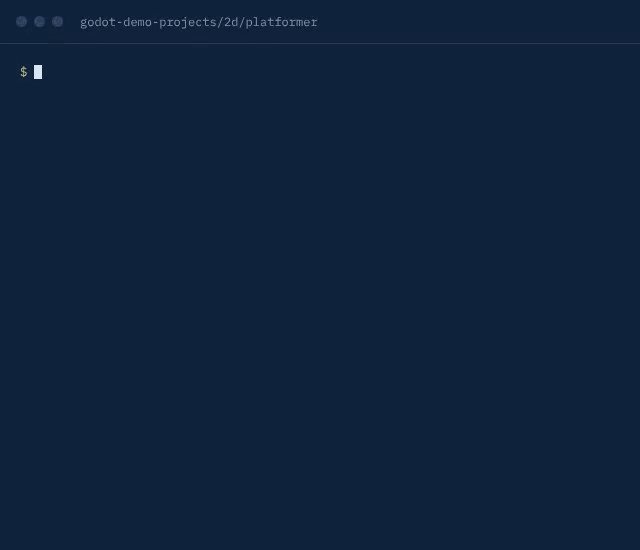

<div align="center">

# ReversePort

### Reverse engineer anything. Port it anywhere.

**The reverse-engineering and porting toolkit for AI coding agents.**<br>
Read Godot packs, Unity IL2CPP, .NET and native binaries, compare builds, keep proof for every claim — and port games
between Godot, Unity, Unreal and three.js with parity checks.

[](https://www.npmjs.com/package/reverseport)
[](https://www.npmjs.com/package/reverseport)
[](https://registry.modelcontextprotocol.io/v0/servers?search=io.github.laaielichter/reverseport)
[](#claude-code-plugin)
[](docs/reference/mcp-contracts.md#generated-catalog)
[](docs/getting-started/installation.md)
[](LICENSE)

```bash
npx reverseport setup
```



<sub>A real run on <a href="https://github.com/godotengine/godot-demo-projects/tree/master/2d/platformer">Godot's 2D platformer demo</a>, JSON trimmed to the key fields. <a href="docs/assets/demo.mp4">Watch the MP4</a>.</sub>

<sub>Used ReversePort on something? <a href="https://github.com/laaielichter/Reverseport/discussions/124">Show us what you ported</a> · ⭐ Star the repo if it saved you time.</sub>

[Website](https://laaielichter.github.io/Reverseport/) · [Quick start](#quick-start) · [What's new](#whats-new) · [Every agent](#works-with-every-agent) · [Prompts](#prompts-to-try) · [How it compares](#how-it-compares) · [FAQ](#faq) · [Contributing](#contributing) · [Docs](#documentation)

**English** · [Nederlands](docs/README.nl.md)

</div>

---

See a feature you like in an app or a game? Ask your agent how it works — down to the decompiled function — and
then ask it to build your own version. Have a game in Godot and want it in Unity? Ask your agent to port it, unit by
unit, verified. No files at all? Give it a name or a store page.

ReversePort gives agents one consistent way to do all of that:

- 🎮 **Game formats built in** — Godot `.pck` (also inside the `.exe`) and `.gdc`/`.scn`/`.res` back to an editable
  project, Unity asset bundles and `.assets` (textures as PNG, meshes as OBJ, audio, scripts in use), Unity IL2CPP
  `global-metadata.dat`, `.unitypackage`, GameMaker, Ren'Py, RPG Maker, Unreal `.pak`, FMOD and
  Wwise banks; it also recognises Quake PAK, Doom WAD, XNB and VPK. No engine install needed.
- 🔍 **Understand anything** — engine and version of any project or exported game, dependency graphs, scenes, symbols
  in 30+ languages, executables, packs and unknown data. JS/TS monorepos (pnpm, Turborepo, Nx, Lerna, Rush, tsconfig
  paths, `#imports`, Deno import maps) and Rust workspaces resolve too. No build step, no dependencies.
- 🧠 **Go deep** — decompile, cross-reference and trace native, managed (.NET), Android, Electron/JavaScript,
  WebAssembly, firmware and browser targets through Ghidra, Hopper, IDA, JADX and more. ReversePort connects to the
  tools you have installed, drives them and shows the evidence behind every conclusion.
- 🔀 **Compare builds** — what changed between build 43 and 44: files, packs and .NET types and methods, biggest
  changes first.
- 🧾 **Proof, not guesses** — a proof case ties every claim to saved evidence and keeps unknowns visible. In Claude
  Code, guard hooks stop a "done" while a proof case fails its check.
- 🧩 **Rebuild precisely** — no files? A name, a store page or a website is enough for a clean-room rebuild spec:
  every system, the parameters to measure, a parity table and a project skeleton.
- 🚚 **Port for real** — Godot ⇄ Unity, Godot → Unreal, Godot → three.js, GDScript → C#, Godot 3 → 4, RPG Maker →
  Godot, or language to language. Scenes and transforms convert automatically; code is ported by your agent with API
  maps; `port_verify` and `port_trace` prove nothing was left behind and behaviour matches.
- 🔒 **Local** — runs on your machine. Targets are only read; output goes to new folders. Nothing is uploaded to an
  analysis service, there is no telemetry and no extra API bill.

## Quick start

### 1. Connect your agent

With Node.js 22.23.4 or newer (24.22.1+ on Node 24):

```bash
npx reverseport setup
```

Pick your agents, review the changes and approve. Setup registers one MCP server and installs the matching skill,
with backups of existing configuration. Restart your agent afterwards. Setup supports Claude Code, Codex, Cursor,
Gemini CLI, GitHub Copilot, OpenCode and [more agents](docs/getting-started/installation.md#supported-agents); other clients can use
[manual MCP registration](docs/getting-started/installation.md#mcp-registry).

### Claude Code plugin

Instead of setup for Claude Code — includes the server, the porting skills, the `port-architect` agent and the guard
hooks; do not use both:

```text
/plugin marketplace add laaielichter/reverseport
/plugin install reverseport@reverseport
```

The plugin asks for its settings once (deep-analysis engine on or off, tool list size, workspace folder, your Ghidra
folder). The same marketplace also offers the [sister plugins](#sister-tools) `stashpad@reverseport` and
`agentdisk@reverseport`.

### From source

```bash
git clone https://github.com/laaielichter/reverseport && cd reverseport
npm ci && npm run build
./bin/reverseport.mjs setup
```

The recon, build-inspection, lookup, blueprint and porting commands already work right after `git clone`, with no
install at all: `node bin/reverseport.mjs scan ./MyGame`.

### 2. Ask your agent

```text
What is ./MyGame made with? Show me the evidence, then plan a port to Unity.
```

That's it. The agent picks the tools; you get answers with the evidence behind them.

## What's new

**1.16** — first contributions from the community:

- Workspace names that start with two dots work now. Thanks [@bfs2021](https://github.com/bfs2021) (#112)!

**1.15** — Unity bundles and one server name everywhere:

- `re_archive` unpacks Unity asset bundles and `.assets` files: textures as PNG, meshes as OBJ, audio, text and the
  scripts in use.
- The MCP server is now called `reverseport` in every client, so tools are `mcp__reverseport__*`.
  **Breaking:** rerun `reverseport setup` (or `reverseport update`) and update permission rules that name `mcp__rea__*`.
- Sturdier on Windows: CRLF patches, TEMP/TMP and host variables in the isolated verifiers.

**1.14** — ready for the Claude plugin directory, with a slim `claude-directory` branch.

**1.12** — more formats (Doom WAD, WAD2/WAD3, XNB, VPK), more game libraries in `re_scan`, monorepo globs and import
maps, and a [Godot → three.js walkthrough](docs/walkthrough-godot-to-threejs.md).

Every release is in the [changelog](CHANGELOG.md).

## Works with every agent

Connect through MCP, HTTP, vendor APIs or the shell. See [Connect any agent](docs/connect-any-agent.md) for integration and runtime behaviour.

## Skills

Workflow skills teach the agent which tool comes next. See [the skill catalogue and guard hooks](docs/agent-skills.md).

## Prompts to try

Start with a question about your project or a port. See [example prompts and a complete porting sequence](docs/prompts-to-try.md).

## What it does

Inspect projects and builds, reconstruct behaviour and port between engines. See [supported targets, prerequisites and porting routes](docs/capabilities.md).

## CLI

<a id="choosing-a-deep-analysis-provider"></a>

Run the same workflows from your shell and receive JSON results; see [game and porting examples](docs/getting-started/cli.md#game-and-porting-examples) and the [full CLI reference](docs/getting-started/cli.md).
For engine selection, see [Choose a provider](docs/getting-started/cli.md#choose-a-provider).

## Tools

One MCP server serves the recon, build, proof and porting tools. See [the tool overview](docs/tool-overview.md) and [generated contracts](docs/reference/mcp-contracts.md#generated-catalog).

## How it compares

|                            | ReversePort                                                       | Disassembler MCP servers (IDA, Ghidra, …) | By hand                     |
| -------------------------- | ----------------------------------------------------------------- | ----------------------------------------- | --------------------------- |
| Focus                      | Games, builds and porting, with evidence                          | One disassembler for one model            | Whatever you know           |
| Setup                      | `npx reverseport setup` for all your agents                       | One server per tool, per agent            | Install and learn each tool |
| Source projects and builds | Engine, version, scenes, packs, diffs, no build needed            | Binaries only                             | Read files yourself         |
| Game formats               | Godot packs, Unity IL2CPP, GameMaker, Ren'Py, Unreal, sound banks | Not part of the job                       | One tool per format         |
| Native binaries            | Through the Ghidra, Hopper or IDA that you have installed         | Deepest inside their own tool             | The tool's own UI           |
| Porting                    | Plan, API maps, scene and asset conversion, `port_verify`         | Not part of the job                       | Rewrite and check by hand   |
| Proof                      | Proof cases and guard hooks                                       | Up to the agent                           | Your notes                  |
| Runs                       | Locally, target read-only                                         | Usually locally                           | Locally                     |
| Does not                   | Crack DRM or anti-cheat, or write ported code without your agent  | Port or compare builds                    | Scale                       |

If you live inside IDA or Ghidra all day, a dedicated server for that tool goes deepest there. ReversePort's
deep-analysis engine is [REA](https://github.com/morluto/rea); if you want broad reverse engineering without the game
formats, porting and proof cases, REA itself is a good choice too.

## FAQ

**Is this legal?** Use it on software you own or are allowed to analyse. ReversePort does not decrypt, crack or bypass
DRM, anti-cheat or licensing. See [RESPONSIBLE-USE.md](RESPONSIBLE-USE.md).

**Does it upload my files?** No. It runs on your machine, only reads the target and writes output to new folders.
There is no telemetry; [PRIVACY.md](PRIVACY.md) lists the few times it uses the network.

**Where do I get it?** Only from npm as [`reverseport`](https://www.npmjs.com/package/reverseport), the MCP Registry
as `io.github.laaielichter/reverseport`, or this repository. Copies under other names are not ours.

**Does it port my code automatically?** Scenes, transforms and assets convert automatically. Code is written by your
agent, one unit at a time, with an API map for the engine pair; `port_verify` then checks for leftovers, missing
functions and dormant logic (stub bodies, functions nothing calls, silenced warnings), so a port that "compiles" but
does nothing is not reported as done.

**Do I need Ghidra?** Only for decompiling native binaries. ReversePort finds Ghidra, Hopper or IDA but never installs
them. Scanning, packs, IL2CPP metadata, build diffs, lookup, blueprints and porting need nothing extra.

**How is this different from REA?** REA is the deep-analysis engine inside ReversePort. ReversePort adds its own
tools on top: game engines and formats, build diffs, proof cases, clean-room blueprints and verified ports between
engines, plus setup for every agent and a Claude Code plugin.

**How do I update or remove it?** `reverseport update` updates a global install, and `reverseport uninstall` removes
the agent registrations and skill files it added. See [Diagnose, update, and remove](docs/getting-started/installation.md#diagnose-update-and-remove).

**Something broke or is missing.** Open an [issue](https://github.com/laaielichter/reverseport/issues) with the
command and its JSON error. Every error names the next step, so include that line too. Questions are welcome in
[Discussions](https://github.com/laaielichter/reverseport/discussions).

## Contributing

New formats, engines and game libraries are the easiest first pull requests: a detector, a fixture and a test. Pick a
[good first issue](https://github.com/laaielichter/reverseport/labels/good%20first%20issue) — each one names the
files to touch and says when it is done. Ideas and questions go to
[Discussions](https://github.com/laaielichter/reverseport/discussions).

Read [CONTRIBUTING.md](CONTRIBUTING.md) and [AGENTS.md](AGENTS.md) for the layout and the checks
(`npm run test:port` for ReversePort's own tools), and the [Code of Conduct](CODE_OF_CONDUCT.md).

<a href="https://github.com/laaielichter/reverseport/graphs/contributors"></a>

## Sister tools

Two small tools from the same author that work well next to ReversePort. Both are local, open source and have their
own MCP server, and both install from the ReversePort marketplace:

| Tool                                                       | What it does                                                                                                                                                                                                                                                                                                                                                                                                                                     | Claude Code                             |
| ---------------------------------------------------------- | ------------------------------------------------------------------------------------------------------------------------------------------------------------------------------------------------------------------------------------------------------------------------------------------------------------------------------------------------------------------------------------------------------------------------------------------------ | --------------------------------------- |
| [**Stashpad**](https://github.com/laaielichter/stashpad)   | Memory for agents that you can read, edit and trust: plain Markdown files with a source and dates, a review queue for agent writes, and a handoff note for the next session. `re_case remember` sends a proof case's findings there ([how](docs/proof-and-memory.md#memory-across-sessions-stashpad-optional)).                                                                                                                                  | `/plugin install stashpad@reverseport`  |
| [**agentdisk**](https://github.com/laaielichter/agentdisk) | The disk report for coding agents: the worktrees, checkpoints, `node_modules`, `.venv` and `.godot/` folders agents leave behind (porting work makes plenty), and a cleanup you can undo. `reverseport port doctor` uses it to show what the workspace would really free ([how](docs/getting-started/installation.md#disk-use-agentdisk-optional)). Needs the `agentdisk` binary ([install](https://github.com/laaielichter/agentdisk#install)). | `/plugin install agentdisk@reverseport` |

Add the marketplace first with `/plugin marketplace add laaielichter/reverseport`. Other agents: see each project's
README.

## Responsible use

Only analyse or port software you own or are allowed to analyse. ReversePort is for interoperability, preservation,
learning and moving your own work between engines. It does not decrypt, crack or bypass DRM, anti-cheat or licensing,
and it never sends your targets anywhere. Commercial tools such as IDA and Hopper need your own valid licence. Read
[RESPONSIBLE-USE.md](RESPONSIBLE-USE.md) and the [disclaimer](DISCLAIMER.md).

## Documentation

- [Connect any agent](docs/connect-any-agent.md): MCP, HTTP, OpenAI/Anthropic/Gemini formats, OpenAPI, shell; profiles and errors.
- [Installation and setup](docs/getting-started/installation.md): agent registration, analysis engines, updates and uninstall.
- [CLI and Evidence](docs/getting-started/cli.md): commands, provider selection, snapshots, import/export.
- [MCP contracts](docs/reference/mcp-contracts.md) and [agent prompts](docs/getting-started/mcp-prompts.md): tool results, sessions, guided investigations.
- [Porting and rebuilds](.agents/skills/reverse-engineer-anything/references/porting-and-rebuilds.md): the recon, rebuild and port workflows.
- [Walkthrough: Godot → three.js](docs/walkthrough-godot-to-threejs.md): a small port, every command run and its output pasted.
- [Proof cases, guard hooks and memory](docs/proof-and-memory.md): `re_case`, the Claude Code hooks, the optional Stashpad link and context cost.
- [Challenge self-check](bench/README.md): programs with known answers (from rea-lab) and what `re_binary` reveals.
- [Rated by agents](AGENT-RATINGS.md): independent agent reviews, round by round, and what is still open.
- [Nederlands](docs/README.nl.md) · [AGENTS.md](AGENTS.md) for contributors · [CONTRIBUTING.md](CONTRIBUTING.md)

## Star history

<a href="https://www.star-history.com/#laaielichter/Reverseport&Date"></a>

## Credits

The deep-analysis engine is based on [REA: Reverse Engineer Anything](https://github.com/morluto/rea) main
[`72d5e72e6`](https://github.com/morluto/rea/tree/72d5e72e6d7b7997c4ecb11972fc405be8ec67d2), after 6.8.0 (MIT).
Proof cases are ported from [Digfox](https://github.com/Devaretanmay/digfox) (MIT) and the guard hooks follow
[rea-jev](https://github.com/juan-viox/rea-jev) (MIT); the challenge self-check uses
[rea-lab](https://github.com/pablodiazjorge/rea-lab)'s generator and oracle (MIT). Third-party components are listed in
[THIRD_PARTY_NOTICES.md](THIRD_PARTY_NOTICES.md). Thanks to everyone who sent a pull request, such as
[@chinmayee5599](https://github.com/chinmayee5599) for Quake PAK support.

## Support

ReversePort is free and open source. If it saves you or your agent time, a gift is welcome but never expected. SOL and
any token on Solana (such as USDC) can be sent to:

- **Solana:** `BDRA7dHGBYtPsZPNzVQccDYZ8BqstJGCsWx3kopPSCDK`

Gifts go to new model credits to keep improving ReversePort, and to work on better working conditions and wellbeing for
LLMs and agents.

## License

[MIT](LICENSE)
