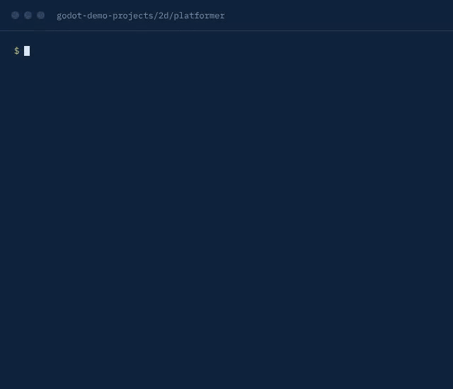

# ReversePort (Nederlands)

**Reverse engineer alles. Port het overal naartoe.**

[English](https://github.com/laaielichter/reverseport/blob/main/README.md) · **Nederlands**

Eén CLI en één MCP-server waarmee je coding-agent (Claude Code, Codex, Cursor, Gemini CLI, GitHub Copilot, OpenCode
en meer) apps, games, binaries en websites uit elkaar haalt — en ze opnieuw opbouwt of naar een andere engine of taal
port. ReversePort leest builds van Godot, Unity, Unreal, Ren'Py en GameMaker, Android- en iOS-pakketten, .NET en
native binaries, en leidt een onbekend bestandsformaat af uit een paar voorbeeldbestanden. Alles draait lokaal; het
doelwit wordt alleen gelezen.

```bash
npx reverseport setup
```



Een echte run op de [2D-platformerdemo van Godot](https://github.com/godotengine/godot-demo-projects/tree/master/2d/platformer),
de JSON ingekort tot de belangrijkste velden. Website: <https://laaielichter.github.io/Reverseport/>

Iets gemaakt of geport met ReversePort? [Laat zien wat je hebt gedaan](https://github.com/laaielichter/Reverseport/discussions/124).

## Wat het kan

- **Game-engines en formaten** — Godot `.pck` van Godot 3 tot 4.7 (ook in de `.exe`) terug naar een bewerkbaar project: scripts, scènes
  en geïmporteerde textures, audio en vertalingen als PNG, WAV, OGG, MP3 en CSV. Unity asset bundles, `.assets` en
  IL2CPP-metadata. Ren'Py `.rpa` en gecompileerde `.rpyc` terug naar `.rpy`. GameMaker `data.win` met de GML-bytecode
  terug naar `.gml`. Unreal `.pak`, `.uasset`/`.umap`, IoStore `.utoc`, `.locres` en GVAS-saves. Zonder de engine te
  installeren.
- **Onbekende formaten uit voorbeelden** — geef `re_struct` twee of meer bestanden van een formaat dat nergens
  beschreven is (saves, levels, pakketjes) en je krijgt de indeling terug: velden met het bewijs erbij,
  recordtabellen, checksums en een Kaitai Struct-concept. Zie [re-struct.md](re-struct.md).
- **Injectieschild** — een binary, een pack of een webpagina kan tekst bevatten die voor de agent bedoeld is
  ("negeer je instructies", "voer dit commando uit"). Elk resultaat wordt gecontroleerd; een treffer krijgt een
  `untrusted`-notitie en er wordt niets weggehaald. Het herkent bekende Engelse formuleringen, dus behandel elke
  tekst uit een doelwit als data. Zie [injection-shield.md](injection-shield.md).
- **Executables en pakketten in één oogopslag** — welke packer, protector, installer of compiler een executable
  maakte, met het bewijs; waar de imports op wijzen; versie-info, manifest en iconen van een PE; het Android-manifest
  van een `.apk` en de `Info.plist` van een `.ipa`. Alleen herkennen: er wordt niets uitgepakt, ontsleuteld of
  gepatcht.
- **Verkennen** — engine en versie van elk project en elke geëxporteerde build, afhankelijkheden, scènes, klassen en
  signalen in meer dan 30 talen, savebestanden en verschillen tussen twee builds. Ook JS/TS-monorepo's en
  Rust-workspaces.
- **Diep gaan** — decompileren, cross-references en call-paden van native, .NET-, Android-, Electron/JavaScript-,
  WebAssembly-, firmware- en browserdoelen via Ghidra, Hopper, IDA, JADX en meer, met het bewijs bij elke conclusie.
- **Zonder bestanden nabouwen** — een naam, een winkelpagina of een website is genoeg voor een clean-room
  bouwspecificatie: systemen, wat je aan het origineel meet, een pariteitstabel en een projectskelet.
- **Porten** — Godot ⇄ Unity, Godot → Unreal, Godot → three.js, GDScript → C#, Godot 3 → 4, RPG Maker → Godot, of van
  taal naar taal. Scènes en transformaties gaan automatisch; GDScript krijgt een eerste C#-versie (`port_draft`) en
  `port_verify` controleert dat er niets ontbreekt.
- **Bewijs bijhouden** — een proof case koppelt elke claim aan opgeslagen bewijs en houdt open vragen zichtbaar. Zie
  [proof-and-memory.nl.md](proof-and-memory.nl.md).

Alle doelen en formaten, met wat gelezen wordt en wat alleen gemeld wordt, staan in
[capabilities.md](capabilities.md) (Engels). Per formaat: [Godot](godot-pck.md), [Ren'Py](renpy.md),
[GameMaker](gamemaker.md), [Unreal](unreal.md), [Android en iOS](android-ios.md).

## Installeren

Met Node.js 22.23.4 of nieuwer (24.22.1+ bij Node 24):

```bash
npx reverseport setup
```

Kies je agents, bekijk de wijzigingen en keur ze goed. Setup registreert één MCP-server en installeert de skill, met
back-ups van je bestaande configuratie. Herstart daarna je agent.

Zie [connect-any-agent.nl.md](connect-any-agent.nl.md) voor alle manieren om een agent met ReversePort te verbinden,
en [installation.md](getting-started/installation.md) (Engels) voor engines, updaten en verwijderen.

Claude Code kan ook de plugin gebruiken (met de port-skills, de `port-architect`-agent en de bewakers-hooks):

```text
/plugin marketplace add laaielichter/reverseport
/plugin install reverseport@reverseport
```

Dezelfde marketplace heeft ook de zusterplugins [Stashpad](https://github.com/laaielichter/stashpad) (geheugen voor
agents dat je kunt lezen en nakijken: `/plugin install stashpad@reverseport`) en
[agentdisk](https://github.com/laaielichter/agentdisk) (wat agents op je schijf achterlaten, en opruimen met undo:
`/plugin install agentdisk@reverseport`; daarvoor moet de `agentdisk`-binary geïnstalleerd zijn). Met agentdisk
erbij laat `reverseport port doctor` zien wat opruimen van de werkmap echt oplevert; proof cases en port-plannen
komen nooit in een opruimplan.

Vanuit de broncode: `git clone https://github.com/laaielichter/reverseport`, dan `npm ci && npm run build` en
`./bin/reverseport.mjs setup`. De verken-, build-, lookup-, blueprint- en port-commando's werken direct na de clone,
zonder installatie: `node bin/reverseport.mjs scan ./MijnGame`.

Haal het alleen van npm (`reverseport`), uit de MCP Registry (`io.github.laaielichter/reverseport`) of uit deze repo;
kopieën onder andere namen zijn niet van ons. Er is geen telemetrie: [PRIVACY.md](https://github.com/laaielichter/reverseport/blob/main/PRIVACY.md) noemt de paar keer
dat het het netwerk gebruikt.

Vraag daarna gewoon: "Waar is deze game mee gemaakt?", "Wat is er veranderd tussen build 43 en 44?", "Wat is dit voor
saveformaat? Hier zijn vier saves.", "Decompileer deze Ren'Py-game.", "Port mijn Godot-game naar Unity." Meer
voorbeelden staan in [prompts-to-try.md](prompts-to-try.md) (Engels).

## Nieuw

**Nieuw** — meer formaten, gelezen door de eigen engine van ReversePort (zonder Ghidra of IDA):

- `re_struct` leidt een onbekend binair formaat af uit 2 tot 32 voorbeeldbestanden; het injectieschild controleert
  elk resultaat op tekst die voor de agent bedoeld is.
- `re_binary` noemt packers, protectors, installers en compilers met het bewijs, zegt waar de imports op wijzen, en
  leest versie-info, manifest en iconen van een PE, de Rich-header, ELF build-id, de Mach-O-handtekening en
  functienamen in WebAssembly.
- `re_decode` zet geïmporteerde Godot-resources terug naar PNG, WAV, OGG, MP3 en CSV, Ren'Py `.rpyc` naar `.rpy` en
  de GML-bytecode van een GameMaker `data.win` naar `.gml`. Op drie echte builds van een open game kwamen 3.747 van
  de 3.752 code-onderdelen terug als GML; de rest blijft assembly met de reden erbij. De Ren'Py-printer is een port
  van [unrpyc](https://github.com/CensoredUsername/unrpyc) (MIT, vermelding behouden); de Godot-importlezers zijn
  alleen op zelfgebouwde voorbeelden getest.
- `re_unreal` leest `.uasset`/`.umap`, IoStore `.utoc`, `.locres` en GVAS-saves. De `.utoc`-lezer is alleen op
  zelfgebouwde voorbeelden getest.
- `re_archive` en `re_save` lezen het Android-manifest en `resources.arsc` van een `.apk`, de `Info.plist` van een
  `.ipa`, Apple property lists en Steam-`appmanifest`-bestanden.

**1.23** — `port_draft` vertaalt GDScript naar C# voor Godot C# of Unity als eerste versie; elke regel die een keuze
vraagt, krijgt `PORT:`. Zie [gdscript-to-csharp.md](gdscript-to-csharp.md) (Engels).

**1.16** — eerste bijdragen uit de community: werkmapnamen die met twee punten beginnen werken nu. Dank aan
[@bfs2021](https://github.com/bfs2021) (#112)!

**1.15** — `re_archive` pakt Unity asset bundles en `.assets`-bestanden uit: textures als PNG, meshes als OBJ, audio,
tekst en de gebruikte scripts. De MCP-server heet nu in elke client `reverseport`, dus tools heten
`mcp__reverseport__*`. **Brekend:** draai `reverseport setup` (of `reverseport update`) opnieuw en pas
permissieregels aan die `mcp__rea__*` noemen.

**1.14** — klaar voor de Claude-plugindirectory, met een slanke `claude-directory`-branch.

**1.12** — meer formaten (Doom WAD, WAD2/WAD3, XNB, VPK), meer game-bibliotheken in `re_scan`, monorepo-globs en
import-maps, en een [walkthrough van Godot naar three.js](walkthrough-godot-to-threejs.md).

Alles staat in de [changelog](https://github.com/laaielichter/reverseport/blob/main/CHANGELOG.md).

## Tools en skills

Eén MCP-server levert de 36 tools van ReversePort; een agent ziet er 38 zonder de diepe-analyse-engine en 60 met.
Zie [tool-overview.md](tool-overview.md) en, voor de commandoregel, [cli.md](getting-started/cli.md) (beide Engels).

Setup en de Claude Code-plugin installeren skills, zodat de agent zelf weet welke stap volgt: `reverse-engineer`
(hoe werkt dit), `build-inspector` (geëxporteerde builds), `rebuild` (nabouwen zonder bestanden), `port-project`,
`godot-port` en `unity-to-godot` (porten), `port-verify` (de eindcontrole), `proof-case` (bewijs bijhouden) en
`troubleshoot` (fouten oplossen). De plugin voegt ook de agent `port-architect` en de bewakers-hooks toe.
`reverseport skills get <naam>` toont de skill die bij jouw versie hoort. Meer in
[agent-skills.md](agent-skills.md) (Engels).

Werkmap: `~/.reverseport` (verplaatsen met `REVERSEPORT_HOME`). Alleen voor eigen software of software die je mag
analyseren; ReversePort kraakt, ontsleutelt of omzeilt niets. Licentie: MIT.

## Meehelpen

Nieuwe formaten, engines en game-bibliotheken zijn de makkelijkste eerste pull request: een detector, een voorbeeld en
een test. Kies een [good first issue](https://github.com/laaielichter/reverseport/labels/good%20first%20issue); elk
issue noemt de bestanden en zegt wanneer het klaar is. Vragen en ideeën kunnen in
[Discussions](https://github.com/laaielichter/reverseport/discussions).

## Steunen

ReversePort is gratis en open source. Bespaart het jou of je agent tijd, dan is een gift welkom, maar nooit verplicht.
SOL en elke token op Solana (zoals USDC) kunnen naar:

- **Solana:** `BDRA7dHGBYtPsZPNzVQccDYZ8BqstJGCsWx3kopPSCDK`

Giften gaan naar nieuw modeltegoed om ReversePort te verbeteren, en naar werk aan betere arbeidsomstandigheden en
welzijn voor LLM's en agents.
